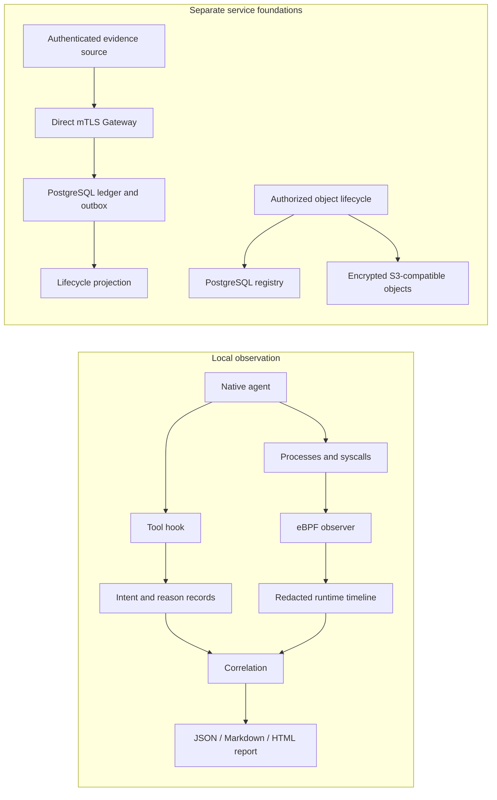

# Architecture

[English](design.md) | [简体中文](design.zh-CN.md) | [README](../README.md)

Apolysis records what an agent declares, what a runtime observes, and which
relations the evidence supports. The current source contains a usable local
Linux observation path and separate authenticated Gateway/storage foundations.
Both are experimental. The native launcher does not automatically upload its
JSONL files to the Gateway, and a public Query service or investigation console
is not implemented.

## Evidence model

| Concept | Meaning |
| --- | --- |
| Agent Run | Work pursued under an authority in one or more execution environments. A local capture session is an observation boundary, not a universal run identity. |
| Tool Call | A declared request to a tool, independent of whether execution is observed. |
| Semantic Evidence | Tool declarations, declared reasons and other producer-supplied activity. |
| Execution Evidence | Operations visible at a particular runtime boundary. Current file/network probes record attempts. |
| Outcome Evidence | An independent check of a claimed result; a successful tool exit is insufficient. |
| Exact Relation | A relation established by a unique explicitly propagated identifier within its trust boundary. It is not proof of motive or authorization. |
| Finding | A condition derived from evidence, such as missing declarations or unsupported enforcement. |

Semantic, execution and outcome coverage are separate. An unobserved declaration
is not proof that the tool did nothing; an unattributed event is not automatically
malicious. Loss, unsupported sources and ambiguous relations remain visible.

## Components and data flow



| Code boundary | Responsibility |
| --- | --- |
| [`apolysis-cli`](../crates/apolysis-cli/src) and [`hooks`](../hooks) | Native launch, product adapters, imports, Tool Call correlation and reports. |
| [`apolysis-core`](../crates/apolysis-core/src) and [`apolysis-store`](../crates/apolysis-store/src) | Local JSONL records, append storage, rotation and optional hash-chain envelopes. |
| [`apolysis-observer`](../crates/apolysis-observer/src) and [`ebpf/observer`](../ebpf/observer) | Scope tracking, kernel capture, decoding, process identity and persistence-time redaction. |
| [`apolysis-daemon`](../crates/apolysis-daemon/src), [`apolysis-accountability`](../crates/apolysis-accountability/src) | Long-running collection, session registration, scope updates, retention and findings. |
| [`apolysis-runtime`](../crates/apolysis-runtime/src), [`apolysis-kubernetes`](../crates/apolysis-kubernetes/src), [`apolysis-visibility`](../crates/apolysis-visibility/src) | Runtime identities, workload metadata and explicit visibility boundaries. |
| [`apolysis-policy`](../crates/apolysis-policy/src), [`apolysis-feedback`](../crates/apolysis-feedback/src), [`apolysis-validation`](../crates/apolysis-validation/src) | Policy decisions, feedback, capability checks and isolated validation tools. |
| [`apolysis-contracts`](../crates/apolysis-contracts/src) | Versioned record, source, coverage, Gateway and Query wire types; no storage or transport implementation. |
| [`apolysis-gateway`](../crates/apolysis-gateway/src), [`apolysis-gateway-server`](../crates/apolysis-gateway-server/src), [`apolysis-gateway-postgres`](../crates/apolysis-gateway-postgres/src) | Authenticated write lifecycle, direct-mTLS transport and transactional persistence. |
| [`apolysis-evidence-objects`](../crates/apolysis-evidence-objects/src), [`apolysis-projection-postgres`](../crates/apolysis-projection-postgres/src) | Authorized object storage/deletion and a durable lifecycle read model. |

## Native application lifecycle

`apolysis observe --agent <product> -- <native arguments>` runs the installed
application as the invoking user. Arguments after `--` retain their boundaries
and order; they are not reconstructed as a shell command. The original terminal,
stdio, tools, authentication, application history and permission prompts remain
under the application's control. Standalone native help/version queries bypass
capture and privilege elevation.

| Product | Temporary integration |
| --- | --- |
| Codex | Session-layer `PreToolUse` configuration, hooks enabled, and `--no-daemon` to keep local work in the observed process tree. Native hook trust remains effective. |
| Claude Code | Additional runtime plugin containing `UserPromptSubmit` and `PreToolUse`. |
| Cursor Agent | Additional runtime plugin containing `beforeSubmitPrompt`, `preToolUse` and `beforeShellExecution`; the supplementary shell event records/allows rather than independently assigning a new call. |
| Pi | Extension listening to `tool_call` (and `input` when `--allow-reason-summary` is enabled), using the native session context. |
| OpenCode | Plugin directory listening to V2 `tool.hook("execute.before")` / `session.hook("prompt")` and V1 `tool.execute.before`, appended to the in-memory native configuration with `--standalone` so execution stays in the observed process tree. |

Existing global/project configuration is not overwritten. Known options that
disable the integration or move execution into remote, detached or shared-server
processes are rejected explicitly. Other hooks or native trust decisions can
still prevent or alter capture. Codex hosted WebSearch does not use its local
`PreToolUse` path, so this adapter cannot declare coverage of that source.

The Rust controller runs as the invoking user and creates private temporary hook
configuration and a gated child process. A separate sudo collector receives only capture setup over
a private Unix socket, validates the child identity and prepares the probes.
Native arguments and prompts are not placed in sudo argv or a launch file.
The controller releases the child only after readiness, gives it the foreground
terminal, and observes its actual exit before requesting a final drain.
Initial cwd and `PWD` agree; native directory options are still applied by the
application itself.

Only the collector is privileged. Its source capture is root-private; the
normal-user controller publishes exported evidence atomically as mode `0600`
inside a mode-`0700` directory. Cancellation restores the terminal and cleans up
the owned process group and collector. A later export failure does not erase an
already observed native exit code or signal. Controlled native capture uses an
8 MiB ring, verified before readiness; legacy observer/daemon defaults are
unchanged. Native timeline export and report inputs are bounded to 64 MiB per
artifact; exceeding the bound produces incomplete evidence.

## Tool identity and declared reasons

Live hooks normalize input to an `intent` record. The capture `session_id`,
product `intent_source`, native `harness_session_id` and native call
`source_event_id` stay distinct. A length-framed SHA-256 derivation over those
identities produces the 32-character lowercase hexadecimal `intent_id`; it is
not a 32-bit integer. Locked append deduplicates retries and rejects conflicting
persisted records. Differences confined to discarded arguments cannot be
detected by that comparison.

Supported local shell calls receive this leading complete comment:

```sh
# APOLYSIS_INTENT_ID=<intent_id>
```

The rest of the command and unrelated tool-input fields are preserved. The hook
returns the modified input through the product's native protocol. Read/search
and remote tools generally retain declarations as `semantic_only`; a declaration
does not promise a matching local syscall. Cursor HTTP MCP calls ignore command
rewriting and remain semantic-only. Imported records use `historical` where
appropriate.

A product may wrap the command in `eval`, hiding the leading marker from the
actual shell exec argument. The optional `--shell-bridge /bin/bash` creates a
supported inner-shell boundary carrying the marker. It is explicit because cwd,
variables and functions changed inside that shell do not propagate to the outer
shell. Neither a successful hook response nor bridge selection proves execution.

`intent_reason` is a separate append-only record linked to the same call identity.
It is an annotation, not hidden model reasoning or verified intent:

- A producer explicitly supplies `apolysis_reason`, or a shell command supplies
  a leading `# APOLYSIS_REASON_CODE=<code>` comment. The source is
  `agent_declared`; the intent marker remains first in the executable command.
- Codes are `unknown`, `inspect_context`, `verify_change`, `reproduce_issue`,
  `implement_change`, `diagnose_failure` and `gather_evidence`.
- Native tool descriptions and opt-in prompt-hook summaries use
  `tool_description` with code `unknown`. Missing reasons stay missing. The
  native launcher injects no reason-generation prompt.
- Summaries are absent by default. `--allow-reason-summary` opts into filtered,
  single-line text of at most 240 Unicode characters (combining sanitized user
  prompt text and tool description when available). Filtering is not a secrecy
  guarantee. `task_ref` is an opaque reference, not prompt content.
- Corrections append a new reason with `supersedes_reason_id`. Binding validates
  the full call identity and correction chain; conflicting or unbound reasons
  cannot create an execution relation.

The older `apolysis chat` command remains a controlled Claude/Bash experiment
with an explicit reason protocol. It is separate from native launch and does
not establish automatic reason extraction for ordinary applications.

## Kernel attribution and correlation

The observer scopes collection to configured process trees or cgroups. It
observes process lifecycle and selected `exec`, file-operation and `connect`
tracepoints. Standard I/O, file contents and decrypted HTTP bodies are not part
of the default observer. Host-side observations of gVisor or VM-backed runtimes
do not imply visibility into guest operations.

The marker parser accepts only a complete leading comment in a supported shell
command argument (recognizing standard short/long shell flags and `-o`/`-O`
option pairs before `-c` or a script path). It does not search arbitrary argv
text. Attribution uses TGID and the thread-group leader's start time to
distinguish reused PIDs. The kernel copies attribution at fork, including
children that never exec. At exec, a valid new marker replaces the current
value; complete capture with no new marker (including child shells executing
scripts with supported flags) preserves it. Unreadable, malformed, unknown-flag
or incomplete marker capture clears the value and sets
`intent_capture_incomplete`. Context is removed when the thread group exits.
Each in-scope event carries its current attribution; userspace does not invent
a missing marker from stale process state.

Correlation is a separate pass restricted to one capture session. A unique
explicit `intent_id`, or a unique explicit `raw_event_id` when no intent marker
is present, can establish an Exact Relation. If both exist, they must agree.
Unknown, conflicting or ambiguous identifiers produce diagnostics rather than
falling back to a heuristic. One Tool Call may link to many observed attempts.
Matching command/executable metadata yields only inferred or ambiguous
candidates. Reason binding can enrich a validated relation but cannot promote
a candidate or semantic-only declaration to exact execution evidence.

## Local records and reports

Local JSONL types live in [`apolysis-core`](../crates/apolysis-core/src/lib.rs),
with reasons in [`intent_reason.rs`](../crates/apolysis-core/src/intent_reason.rs).
They remain an edge format, separate from the authenticated service contract.

| Native-run artifact | Contents |
| --- | --- |
| `intent.jsonl` | Normalized Tool Call declarations and observation modes. |
| `intent.jsonl.reasons.jsonl` | Declared reason codes, sources and explicitly retained summaries. |
| `timeline.jsonl` | Redacted raw/canonical events, runtime metadata and capture diagnostics. |
| `correlation.jsonl` | Exact Relations, candidates, reason bindings and findings. |
| `result.json`, `report.md`, `report.html` | Structured and human-readable views grouped by Tool Call. |

Reports validate raw/canonical identity, unique declarations and reason bindings
before counting exact relations, and emit an English session summary tree on
stderr upon completion. Raw events and canonical copies are not counted as two
syscall attempts. Unattributed events, policy notices, missing reasons,
conflicts, truncation and loss stay separate. Malformed, foreign-session,
missing or oversized inputs make the report incomplete.

Application exit, capture completion, correlation integrity and task outcome
have independent fields. `complete` means the corresponding artifact checks
passed, not that all operations were visible or attributed. The generic task
outcome remains `not_verified`; an independent result check is required.

## Runtime metadata and policy

Daemon adapters register local, Docker/containerd and Kubernetes workloads and
update their observation scopes. Runtime identities and process generations
prevent a reused PID or unrelated workload from silently inheriting a session.
A runtime/visibility report describes the observed boundary rather than claiming
that the host can see inside every container or virtual machine.

Policy evaluation records the requested decision, available capability,
effective backend and any downgrade. The native observer runs in audit mode;
tracepoint feedback is not pre-operation prevention. Separate BPF-LSM and
seccomp file-read prototypes exercise specific blocking paths. Their bounded
validation does not turn the ordinary observer into a general sandbox or extend
blocking to every runtime/action. A policy decision and confirmed actuation
remain different evidence.

## Authenticated Gateway and durable storage

[`apolysis-contracts`](../crates/apolysis-contracts/src) owns validated v0.1 types
and [generated JSON Schemas](../schemas/contracts/v0.1). An Agent Execution Record
combines organization/run identity, authenticated source envelopes, ordering,
coverage and lifecycle facts. Legacy JSONL is not reused as the Gateway or Query
wire schema. Query/Console types define a contract, not an implemented UI/API.

The Gateway exposes four direct-mTLS POST routes under `/gateway/v0.1/`:
`open-run`, `bind-runtime`, `ingest` and `finish-run`. It derives identity from
the verified client-certificate fingerprint and resolves current authority from
PostgreSQL for each lifecycle request. Request fields, certificate display names
and forwarded-certificate headers cannot assert authority. The authenticated
context is server-only. This write listener has no browser cookie/CORS surface;
lease-bearing request/response bodies are not access-log material.

The application service uses a repository boundary rather than direct database
CRUD. PostgreSQL atomically commits accepted operations, record items and their
matching projection-outbox entries. Organization-scoped sequencing, unique
operation/event identities, canonical request digests and encrypted exact replay
support retries without duplicate ledger effects. Lease/join lookup values are
digests. Runtime binding and bounded finalization are part of the same lifecycle;
terminal runs cannot be revived by a novel request.

The [Gateway migrations](../crates/apolysis-gateway-postgres/migrations) and
[deployment SQL](../crates/apolysis-gateway-postgres/deploy) separate schema ownership,
runtime and control roles.
Served processes do not migrate schemas or own tables. Fixed roles require a
dedicated Apolysis PostgreSQL cluster. This role split is not tenant RLS;
organization isolation still depends on authenticated application scope.

The evidence-object module admits bytes only under the current source/run,
capability, privacy, retention and quota policy. It reserves metadata, encrypts
and uploads through a server-owned S3 client, then reads back and verifies exact
size and SHA-256 before marking the object available. The in-memory plaintext
limit is 64 MiB. An `EvidenceObjectRef` is integrity metadata, never a bearer
read capability; an authenticated object-read resolver is not implemented.
Deletion makes the object unavailable, purges storage material and waits for
registered consumer acknowledgements before releasing quota and leaving a tombstone.

The lifecycle projection consumes durable outbox facts in ingest order. It has
organization-qualified generations, exact watermarks and rebuild/cutover; its
read model is internal and lifecycle-only. It does not yet provide public Query
authorization, SSE, source-health/findings views or a console.

These services are foundations, not a production deployment claim. Authority
lookup is not yet atomically revalidated with ledger commit; production key
custody/rotation, public read authorization, capacity bounds and operational
recovery/availability remain incomplete. Qualification-only crash/race controls
are confined to separate feature-gated binaries and are not server API options.

## Privacy and trust boundaries

Runtime persistence removes exec argv and reconstructed commands. Intent command
metadata retains only a redacted executable reference. The collector may read
argv transiently for attribution; content-off persistence does not mean
capture-off. Prompts, full tool parameters, results and provider streams are not
Apolysis report inputs. Workspace paths and structural metadata can still be
sensitive; out-of-workspace paths and addresses are tokenized within the capture.
The native application's own conversation history is governed by that product.

Hook identities and markers are cooperative declarations, not authenticated
proof of authorship against a hostile agent. User-owned exports can be modified
by the same user. A daemon-local hash chain detects inconsistency relative to its
chain, but has no independent external anchor. Privileged host control, source
compromise or missing runtime visibility can invalidate assumptions; neither
empty findings nor a matching identifier proves safety or complete execution.
