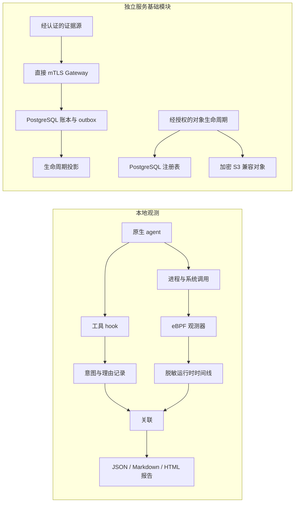

# 架构设计

[English](design.md) | [简体中文](design.zh-CN.md) | [README](../README.zh-CN.md)

Apolysis 记录 agent 的声明、运行时观测，以及证据能够支持的关联。当前源码包含可用的
本地 Linux 观测链路，以及独立的认证 Gateway 与存储基础模块，两者仍处于实验阶段。
原生启动入口不会自动把 JSONL 上传到 Gateway，公共 Query 服务和调查控制台尚未实现。

## 证据模型

| 概念 | 含义 |
| --- | --- |
| Agent Run | 在某个授权主体下、跨一个或多个执行环境开展的工作。本地采集会话是观测边界，不等同于通用运行身份。 |
| Tool Call | 对工具的一次声明请求，与是否观测到执行分开记录。 |
| Semantic Evidence（语义证据） | 工具声明、声明理由，以及生产者提供的其他活动信息。 |
| Execution Evidence（执行证据） | 某个运行时边界内可见的操作；当前文件与网络探针记录的是尝试。 |
| Outcome Evidence（结果证据） | 对所声称结果的独立检查；工具正常退出不足以证明结果。 |
| Exact Relation（精确关联） | 在明确的信任边界内，通过唯一、显式传播的标识符建立的关系，不证明动机或授权。 |
| Finding（发现项） | 从证据得出的条件，例如缺失声明或不支持的强制执行能力。 |

语义、执行和结果覆盖率分别表达。没有观测到某次声明的执行，不代表工具什么都没做；
无法归属的事件也不自动等于恶意行为。丢失、不支持的数据源和歧义关联都应保留。

## 组件与数据流



| 代码边界 | 职责 |
| --- | --- |
| [`apolysis-cli`](../crates/apolysis-cli/src) 与 [`hooks`](../hooks) | 原生启动、产品适配、导入、Tool Call 关联和报告。 |
| [`apolysis-core`](../crates/apolysis-core/src) 与 [`apolysis-store`](../crates/apolysis-store/src) | 本地 JSONL 记录、追加存储、轮转和可选哈希链封装。 |
| [`apolysis-observer`](../crates/apolysis-observer/src) 与 [`ebpf/observer`](../ebpf/observer) | 范围跟踪、内核采集、解码、进程身份和持久化脱敏。 |
| [`apolysis-daemon`](../crates/apolysis-daemon/src)、[`apolysis-accountability`](../crates/apolysis-accountability/src) | 持续采集、会话登记、范围更新、保留策略和发现项。 |
| [`apolysis-runtime`](../crates/apolysis-runtime/src)、[`apolysis-kubernetes`](../crates/apolysis-kubernetes/src)、[`apolysis-visibility`](../crates/apolysis-visibility/src) | 运行时身份、工作负载元数据和明确的可见性边界。 |
| [`apolysis-policy`](../crates/apolysis-policy/src)、[`apolysis-feedback`](../crates/apolysis-feedback/src)、[`apolysis-validation`](../crates/apolysis-validation/src) | 策略决策、反馈、能力检查和独立验证工具。 |
| [`apolysis-contracts`](../crates/apolysis-contracts/src) | 版本化记录、来源、覆盖率、Gateway 和 Query 线协议类型，不实现存储或传输。 |
| [`apolysis-gateway`](../crates/apolysis-gateway/src)、[`apolysis-gateway-server`](../crates/apolysis-gateway-server/src)、[`apolysis-gateway-postgres`](../crates/apolysis-gateway-postgres/src) | 经认证的写入生命周期、直接 mTLS 传输和事务持久化。 |
| [`apolysis-evidence-objects`](../crates/apolysis-evidence-objects/src)、[`apolysis-projection-postgres`](../crates/apolysis-projection-postgres/src) | 经授权的对象存储与删除，以及持久化生命周期读模型。 |

## 原生应用生命周期

`apolysis observe --agent <product> -- <原生参数>` 以调用用户身份运行已安装的应用。
`--` 后的参数保留边界和顺序，不会重新拼成 shell 命令。原来的终端、标准输入输出、
工具、认证、应用历史记录和权限提示仍由原生应用管理。单独查询原生帮助或版本时，
不采集、不申请提权。

| 产品 | 临时接入方式 |
| --- | --- |
| Codex | 会话层 `PreToolUse` 配置，启用 hooks，并使用 `--no-daemon` 把本地执行保留在观测进程树内；原生 hook 信任检查继续生效。 |
| Claude Code | 额外加载包含 `PreToolUse` 的运行时插件。 |
| Cursor Agent | 额外加载含 `preToolUse` 和 `beforeShellExecution` 的运行时插件；补充 shell 事件记录并放行，不独立生成新的调用身份。 |
| Pi | 监听 `tool_call` 的扩展，从原生上下文读取会话。 |
| OpenCode | 监听 `tool.execute.before` 的插件，追加到内存中的原生配置，并使用插件目录上下文。 |

现有全局或项目配置不会被覆盖。已识别的禁用接入、远程执行、后台分离或共享服务器
选项会被明确拒绝。其他 hook 或原生信任决策仍可能阻止或改变采集。Codex 托管的
WebSearch 不走本地 `PreToolUse`，因此此适配器不能声称覆盖该来源。

Rust 控制器以普通用户身份创建私有临时 hook 配置和一个等待放行的子进程。独立的 sudo 采集器
通过私有 Unix socket 接收采集设置，核对子进程身份并准备探针。原生参数和提示词
不会放入 sudo 参数或落盘启动文件。采集器就绪后，控制器才放行子进程、交给它前台
终端，并在确认实际退出后请求最后一次排空。初始 cwd 与 `PWD` 一致；产品自身的
目录参数仍由原生应用处理。

只有采集器拥有特权。其源采集文件置于 root 私有目录，普通用户控制器再原子发布到
权限为 `0700` 的目录，导出文件权限为 `0600`。取消时恢复终端并清理所拥有的进程组
和采集器。后续导出失败不会抹掉已经观测到的原生退出码或信号。受控原生采集使用
8 MiB ring buffer，并在就绪前核验实际容量；原有 observer/daemon 默认值不变。
原生时间线导出和报告读取的单个输入文件上限为 64 MiB，超限会形成不完整证据。

## 工具身份与声明理由

实时 hook 把输入统一为 `intent` 记录。采集 `session_id`、产品 `intent_source`、
原生 `harness_session_id` 和调用 `source_event_id` 分开保存。对这些身份进行长度分帧
并计算 SHA-256，派生出 32 字符小写十六进制 `intent_id`；它不是 32 位整数。
加锁追加会去重重试，并拒绝内容冲突的持久化记录。差异若仅存在于已丢弃的参数中，
这项比较无法识别。

受支持的本地 shell 调用会加上这条完整的首行注释：

```sh
# APOLYSIS_INTENT_ID=<intent_id>
```

其余命令和无关工具输入字段保持原样，由 hook 通过产品原生协议交还修改后的输入。
读文件、搜索及远程工具通常仅保留 `semantic_only` 声明；有声明不代表应当存在本地
系统调用。Cursor 的 HTTP MCP 调用忽略命令改写，也属于仅语义记录。导入的历史记录
在适用时使用 `historical` 模式。

产品可能再用 `eval` 包裹命令，使注释不再位于真实 shell exec 参数的开头。可选的
`--shell-bridge /bin/bash` 创建一个携带标记、可识别的内部 shell 边界。该选项需要
显式启用，因为内部 shell 对 cwd、变量和函数的改变不会传回外层 shell。hook 返回
成功或选择了 bridge，都不能证明工具已经执行。

`intent_reason` 是按同一调用身份关联的独立追加记录。它是声明注解，不是模型的
隐藏推理，也不是经验证的动机：

- 生产者显式提供 `apolysis_reason`，或在 shell 命令前写入
  `# APOLYSIS_REASON_CODE=<code>`。来源为 `agent_declared`，可执行命令中的意图标记
  仍处于首行。
- 理由码为 `unknown`、`inspect_context`、`verify_change`、`reproduce_issue`、
  `implement_change`、`diagnose_failure` 和 `gather_evidence`。
- 原生工具描述记录为 `tool_description`，理由码为 `unknown`。缺失理由保持缺失；
  原生启动入口不注入生成理由的提示词。
- 默认不保存摘要。`--allow-reason-summary` 显式允许保存经过过滤、最多 240 个 Unicode
  字符的单行文字；过滤不保证任意文字不含秘密。`task_ref` 是不透明引用，不是提示词。
- 更正通过新记录的 `supersedes_reason_id` 追加表达。绑定时检查完整调用身份与更正链；
  冲突或未绑定的理由不能建立执行关联。

原有 `apolysis chat` 仍是使用显式理由协议的受控 Claude/Bash 实验，与原生启动入口
分开，也不能证明普通应用具备自动理由提取能力。

## 内核归属与关联

观测器按配置的进程树或 cgroup 限定采集范围，观测进程生命周期以及选定的 `exec`、
文件操作和 `connect` tracepoint。标准输入输出、文件内容和解密后的 HTTP 正文不在
默认观测范围内。对 gVisor 或虚拟机运行时的宿主侧观测，不等于看到了内部操作。

标记解析器只接受受支持 shell 命令参数最前面的完整注释，不搜索任意 argv 文本。
归属使用 TGID 和线程组首线程启动时间，以区分 PID 重用。内核在 fork 时复制归属，
包括之后没有 exec 的子进程。exec 遇到合法新标记时替换；完整读取且没有新标记时
保留；读取失败、格式错误或标记采集不完整时清空，并标记 `intent_capture_incomplete`。
线程组退出时删除上下文。范围内每个事件携带当时的归属，用户态不会用旧进程状态
补造缺失的标记。

关联是限制在同一采集会话内的独立步骤。唯一的显式 `intent_id`，或没有意图标记时
唯一的显式 `raw_event_id`，可以建立 Exact Relation；两者同时存在时必须一致。
未知、冲突或有歧义的标识符产生诊断，不退回启发式匹配。一次 Tool Call 可以关联
多个操作尝试。相同命令或可执行文件元数据只形成 inferred 或 ambiguous 候选。
理由绑定可以补充已验证的关系，但不能把候选或仅语义声明升级为精确执行证据。

## 本地记录与报告

本地 JSONL 类型定义在 [`apolysis-core`](../crates/apolysis-core/src/lib.rs)，理由定义在
[`intent_reason.rs`](../crates/apolysis-core/src/intent_reason.rs)。它们是边缘记录格式，
与经认证的服务协议分开。

| 原生采集文件 | 内容 |
| --- | --- |
| `intent.jsonl` | 统一的 Tool Call 声明及观测模式。 |
| `intent.jsonl.reasons.jsonl` | 声明理由码、来源和显式允许保留的摘要。 |
| `timeline.jsonl` | 脱敏原始/规范化事件、运行时元数据和采集诊断。 |
| `correlation.jsonl` | 精确关联、候选、理由绑定和发现项。 |
| `result.json`、`report.md`、`report.html` | 按 Tool Call 分组的结构化及可读视图。 |

报告先核对原始/规范化事件身份、唯一声明及理由绑定，再统计精确关联。原始事件和
规范化副本不会重复计为两次系统调用尝试。未归属事件、策略通知、缺失理由、冲突、
截断和丢失分别呈现。输入缺失、损坏、混入其他会话或超限时，报告标记为不完整。

应用退出、采集收尾、关联完整性和任务结果各有独立字段。`complete` 表示对应的文件
检查通过，不表示所有操作都可见或已经归属。通用任务结果保持 `not_verified`，需要
独立的结果检查才能确认。

## 运行时元数据与策略

daemon 适配器登记本地、Docker/containerd 和 Kubernetes 工作负载，并更新观测范围。
运行时身份与进程代际信息用于防止重用的 PID 或无关工作负载静默继承会话。
运行时/可见性报告描述实际观测边界，不声称宿主能看见所有容器或虚拟机内部。

策略评估记录请求决策、可用能力、实际后端和降级原因。原生观测入口运行在审计模式，
tracepoint 反馈不是操作前阻断。独立的 BPF-LSM 与 seccomp 文件读取原型验证特定阻断
路径，其有限验证不会让普通观测器成为通用隔离环境，也不会把阻断能力推广到所有
运行时或操作。策略决策与已经确认的执行措施是不同的证据。

## 经认证的 Gateway 与持久化存储

[`apolysis-contracts`](../crates/apolysis-contracts/src) 拥有经验证的 v0.1 类型和
[生成的 JSON Schema](../schemas/contracts/v0.1)。Agent Execution Record 组合组织/运行
身份、经认证来源的 envelope、顺序、覆盖率和生命周期事实。本地 JSONL 不直接复用为
Gateway 或 Query 线协议。Query/Console 类型是接口约定，不代表对应服务或界面已实现。

Gateway 在 `/gateway/v0.1/` 下提供四个直接 mTLS POST 路由：`open-run`、`bind-runtime`、
`ingest` 和 `finish-run`。它根据已验证客户端证书的指纹识别身份，并对每次生命周期
请求从 PostgreSQL 解析当前权限。请求字段、证书展示名称和转发证书请求头不能声明
权限，认证上下文仅存在于服务端。写入监听器不提供浏览器 cookie/CORS 接口；包含
租约凭据的请求和响应正文不应进入访问日志。

应用服务通过 repository 边界工作，不直接操作数据库 CRUD。PostgreSQL 原子提交已接受
的操作、记录项和一一对应的 projection outbox 条目。组织范围的顺序、唯一操作/事件
身份、规范化请求摘要与加密精确重放，使重试不重复产生账本效果。租约与加入证明仅
保留查找摘要。运行时绑定和有界结束处理属于同一生命周期，新的请求不能复活终态运行。

[Gateway 迁移](../crates/apolysis-gateway-postgres/migrations)和
[部署 SQL](../crates/apolysis-gateway-postgres/deploy)区分
schema 所有者、运行时与管理角色。服务进程不执行迁移，也不拥有表。固定角色要求使用
独立的 Apolysis PostgreSQL 集群。这种角色拆分不是租户 RLS，组织隔离仍依赖经认证的
应用作用域。

证据对象模块仅在当前来源/运行、能力、隐私、保留和配额策略允许时接收字节。它先预留
元数据，再通过服务端持有的 S3 客户端加密上传，随后读回核验精确大小和 SHA-256，
通过后才标记为可用。内存中明文上限为 64 MiB。`EvidenceObjectRef` 是完整性元数据，
不是持有即能读取的凭据；经认证的对象读取解析器尚未实现。删除时先标记为不可用，清除
存储材料，并等待已登记消费者确认，之后才释放配额并留下墓碑记录。

生命周期投影按 ingest 顺序消费持久化 outbox 事实，支持组织限定的 generation、精确
watermark 及重建/切换。它是内部生命周期读模型，不提供公共 Query 授权、SSE、来源
健康/发现项视图或控制台。

这些服务是基础模块，不代表已可用于生产。权限查询尚未与账本提交原子地重新校验；
生产密钥托管/轮转、公共读取授权、容量边界和运行恢复/可用性仍不完整。用于崩溃或
竞争验证的控制接口仅编入单独的特性开关验证程序，不是服务 API 选项。

## 隐私与信任边界

运行时持久化会移除 exec argv 和重建的命令，意图中的命令元数据只保留脱敏可执行文件
引用。采集器仍可能为归属短暂读取 argv，因此 content-off 持久化不等于 capture-off。
提示词、完整工具参数、工具结果和 provider 流不是 Apolysis 报告输入。工作区路径和
结构化元数据仍可能敏感；工作区外路径和地址会在采集会话范围内转换为 token。
原生应用自己的对话历史仍按该产品的规则保留。

hook 身份和标记是协作式声明，不是对抗恶意 agent 的作者认证证明。同一用户可以修改
其拥有的导出文件。daemon 本地哈希链能发现相对于该链的不一致，但没有独立外部锚点。
特权宿主控制、证据源被入侵或运行时不可见，都可能破坏这些前提；没有发现项或标识符
匹配，不能证明安全或完整执行。
